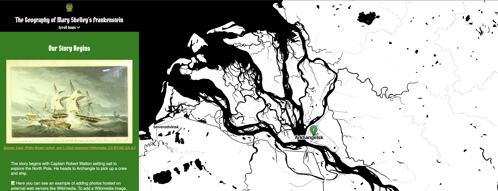
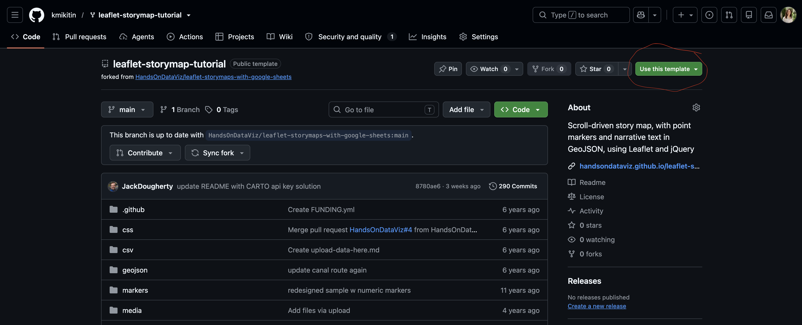
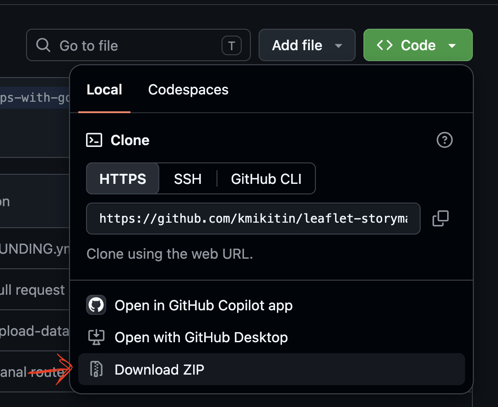
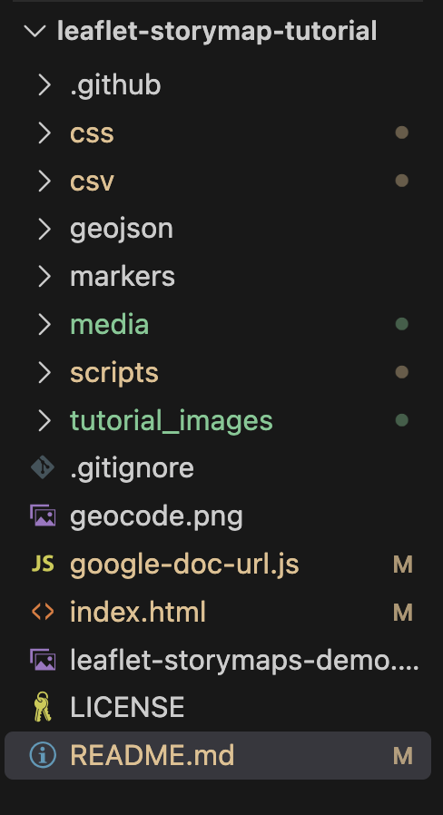
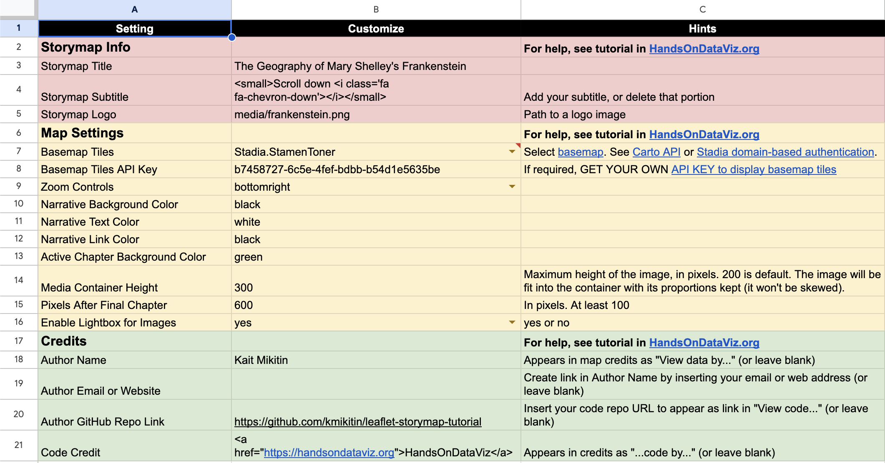
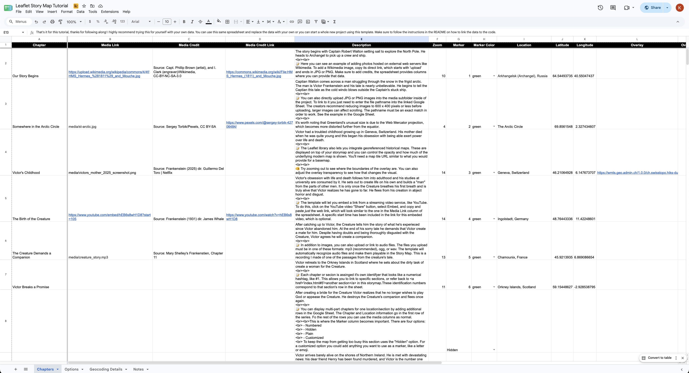

# Creating Leaflet Story Maps using Google Sheets
Welcome to the tutorial on how to create and customize a Leaflet Story Map using a Google Sheets template! By the end of this tutorial you should be able to:
- identify the parts of this repository
- know which parts of the repository you will need to interact with to create your map
- understand what each column in the provided Google Sheet template is for
- create a few of your own Story Map entries for the example Frankenstein Story Map
- know where to go for futher learning

Note that this tutorial is written the the style common for coding tutorials - which is using a `README` file at the root of the project to walk you through the steps. If you chose to do more programming you'll likely come accross this again!

## Start Here
Your first step is to get your own copy of this repository. In the upper righthand corner of this page you should see a green drop down That says `Use this template`. Click that button and select `Create a new repository`.

Name the repository what you want and then click `Create repository`.

In your copy, click the green `< > Code` button and download the the ZIP, as shown in the image below.

  

 

You've now downloaded and example Story Map built for this class that you will extend. Open the repository in your editor of choice. 

## Code Tour
Let's get familiar with the directory (folder) structure of this project. Inside the project directory (mine is named `leaflet-storymap-tutorial`, yours will be whatever you named the repository). You will find 8 subfolders and 7 files in this folder:

  

 

The Google Sheet Leaflet Story Map supports images, audio and video embeddings, and Leaflet TileLayer/geojson overlays. These different types of media get put in their own folders to be used by the code in `/scripts`. The main folder you will interact with for this tutorial is `/media`. This is where any images, audio, or video files get uploaded for use in the Story Map.

You'll notice that just like our class projects, this one has an [`index.html`](index.html) file at the root. Open the file and read through the structure, I've included some comments for guidance. Because the project is powered by a Google Sheet, you won't need to make any changes to this file.

Did you notice that there isn't much JavaScript, but that the file loads other script files in the repository? The scripts for this project are quite long and involved so they are in their own files to keep the project tidy. [`storymap.js`](./scripts/storymap.js) is worth taking a look at, this is the primary engine for the Story Map.

### Keep Exploring
Poke around and look at some of the other scripts and css files. Comments have been added to explain what the files are for. I've also left comments inline from the creators that explain what specific lines do. You won't need to change anything in code for the tutorial but if you want to create your own project knowing which parts of the css files will allow you to customize your project is worthwhile.

## Google Sheet Template Tour
Head to the [spreadsheet](https://docs.google.com/spreadsheets/d/1a_WFP-1PkGYUZJFvlXjJRDxZvkkTBtxsrK_J8snkCkI/edit?gid=1033046795#gid=1033046795). You should be on the `Options` tab when it loads:

  

 

The Options control the appearance of the Story Map. There are explanations for each of the options in the `Hints` column. The `Map Settings` section allows you to do some light customization. For anything more complex you'll need to edit the css file directly (this is not required though, this will work without changes). For your own project if you use this template I recommend you change the [`Font-Family`](./css/style.css#L62) back to something more generic. I customized this for the tutorial.

Most importantly these Setting names directly relate to the constants [here](./scripts/constants.js). It's very important that you don't change these names, only make changes to the Customize column.

Now we'll take a look at the `Chapters` tab:

  

Each row is a chapter, which is a section of the map. Each chapter contains the text of the story (description), links to media, and data about each point on the map. In the next section when you begin the walkthrough you'll be asked to make changes to the data in this tab.

## View the Site to Complete the Tutorial
It's time to run the site! Follow the same process you use for other class labs to view the site. 

📝 - this indicates a note for the tutorial, explaining various features

🫵 - this indicates when it's your turn to try something out

The storymap created for this tutorial will explore the major locations from Frankenstein. It's ok if you aren't familiar with the story - you'll still be able to add new data.

Now it's time to head over to the Story Map, the rest of the tutorial picks up there.

#### IMPORTANT FOR WHEN YOU MAKE YOUR OWN STORY MAP
**To finalize your map, you need to either:**
- Download each Google Sheets tab as a CSV file and upload into the `csv` subfolder in this repository

OR
- Get your own Google Sheets API Key to insert into `google-doc-url.js`

The current API key in that file is from the original tutorial. It is recommended to get your own when running your own project. The same is true for the Stadia basemap API key - that one is from my account but to continue to use it you would replace it with your own API key.

### For Further Learning
- Check out the original tutorial in [*Hands-On Data Visualization*](https://HandsOnDataViz.org/leaflet-storymaps-with-google-sheets.html)
  - The [whole book](https://handsondataviz.org/) is actually very good
- [How to set up your Google API Key](https://support.google.com/googleapi/answer/6158862?hl=en)
- [Managing Stadia Maps API Keys](https://docs.stadiamaps.com/authentication/#api-keys)
- [More on what Lightbox JS is](https://en.wikipedia.org/wiki/Lightbox_(JavaScript))

## Credits (and licenses)
Original code developed by [Ilya Ilyankou](https://github.com/ilyankou) and [Jack Dougherty](https://github.com/jackdougherty) with support from Connecticut Humanities and Trinity College, CT. Inspired by Code for Atlanta mapsfor.us (2016) https://github.com/codeforatlanta/mapsforus (BSD-3-Clause). Adapted from MUX Lab, Map Effects 100: https://github.com/muxlab/map-effects-100, see http://muxlab.github.io/map-effects-100/Leaflet/11_scroll-driven-map-navigation.html.

Uses [Google Sheets API version 4](https://developers.google.com/sheets/api), with these open-source components:

- Leaflet v1.7.1 https://leafletjs.com (BSD-2-Clause)
- jQuery v3.5.1 https://code.jquery.com (MIT)
- PapaParse v5.3.0 to parse CSV with JavaScript (MIT)
- Font Awesome v5.8.1 https://cdn.fontawesome.com (MIT, SIL OFL 1.1)
- leaflet-providers (v4.0.0) https://github.com/leaflet-extras/leaflet-providers (BSD-2-Clause)
- Leaflet.awesome-markers (v2.0.4), manually updated to svg to allow hex and material icons https://github.com/sigma-geosistemas/Leaflet.awesome-markers (MIT)
- Leaflet.ExtraMarkers (v1.0.5) https://github.com/coryasilva/Leaflet.ExtraMarkers (MIT)
- jQuery-CSV (v1.0.11) https://github.com/evanplaice/jquery-csv (MIT)
- Single Element CSS Spinner (31 May 2016) https://github.com/lukehaas/css-loaders (MIT)
- Lightbox by Lokesh Dhakar (v.2.11.3) https://github.com/lokesh/lightbox2 (MIT)
